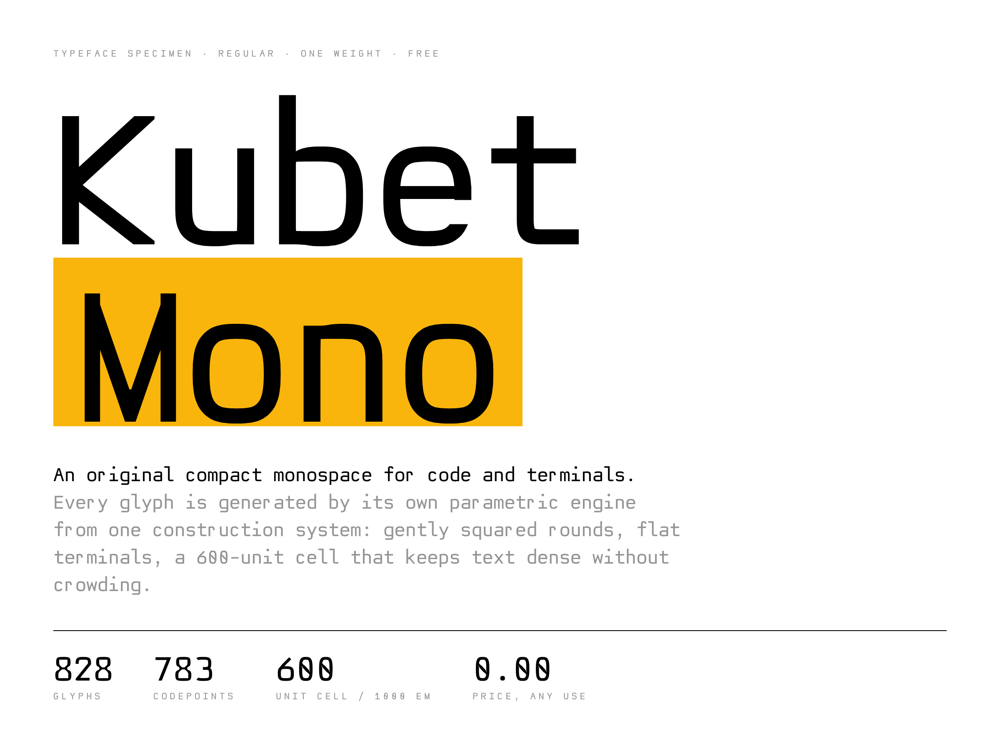
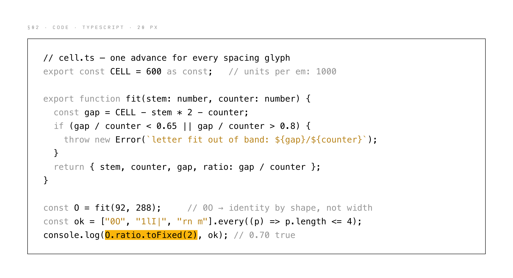
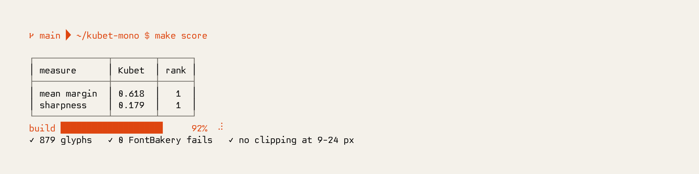
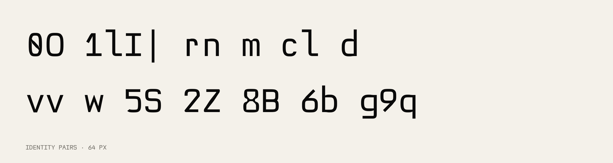

<picture>
  <source media="(prefers-color-scheme: dark)" srcset="docs/plates/hero-dark.png">
  
</picture>

# Kubet Mono

An original monospaced typeface for code and terminals, drawn by its own parametric engine and hill-climbed by a language-model loop. One construction system, one weight, a 600-unit cell that keeps text dense without crowding. Free for personal use; commercial use on approval.

**Specimen and type tester:** [dropthetable.com/kubet-mono](https://dropthetable.com/kubet-mono)

## Install

Download the [latest release](https://github.com/kubet/kubet-mono/releases/latest) or take the files from `fonts/`.

```sh
# macOS
curl -LO https://github.com/kubet/kubet-mono/releases/latest/download/KubetMono-Regular.ttf
mv KubetMono-Regular.ttf ~/Library/Fonts/

# Linux
mkdir -p ~/.local/share/fonts
curl -L -o ~/.local/share/fonts/KubetMono-Regular.ttf \
  https://github.com/kubet/kubet-mono/releases/latest/download/KubetMono-Regular.ttf
fc-cache -f
```

Windows: download the TTF, right-click, Install.

```jsonc
// VS Code
"editor.fontFamily": "Kubet Mono",
"editor.fontLigatures": false
```

```ini
# Ghostty
font-family = Kubet Mono
font-feature = ss01   # slashed zero
```

```css
@font-face {
  font-family: "Kubet Mono";
  src: url("KubetMono-Regular.woff2") format("woff2");
  font-weight: 400;
  font-display: swap;
}
```

<picture>
  <source media="(prefers-color-scheme: dark)" srcset="docs/plates/code-dark.png">
  
</picture>

<picture>
  <source media="(prefers-color-scheme: dark)" srcset="docs/plates/term-dark.png">
  
</picture>

<picture>
  <source media="(prefers-color-scheme: dark)" srcset="docs/plates/pairs-dark.png">
  
</picture>

<picture>
  <source media="(prefers-color-scheme: dark)" srcset="docs/plates/water-dark.png">
  
</picture>

## Datasheet

| | |
| --- | --- |
| Family · style | Kubet Mono · Regular (400), upright |
| Version | 0.001 · 2026-10-26 |
| Units per em | 1000 |
| Advance width | 600, fixed; no kerning |
| Cap height · x-height | 700 · 524 |
| Ascender (l) · descender | 815 · −200 |
| Line height | 1.332 em (1102 / −230) |
| Stem | 92 units |
| Glyphs · codepoints | 828 · 783 |
| OpenType | `ccmp`, `ss01` slashed zero, `mark`, `mkmk` |
| Hinting | `prep` + `gasp`: grayscale antialiasing at every size |
| Embedding | `fsType` 0, installable |

### Coverage

| Block | Cells |
| --- | --- |
| Basic Latin | 95 / 95 |
| Latin-1 Supplement | 96 / 96 |
| Latin Extended-A | 128 / 128 |
| Latin Extended-B digraphs DŽ–nj | 9 / 9 |
| Combining marks | 13 |
| Arrows, math, bullet, ellipsis | 16 |
| Box Drawing | 128 / 128 |
| Block Elements | 32 / 32 |
| Braille Patterns | 256 / 256 |
| Powerline (private use) | 8 |

Languages: English, German, French, Spanish, Portuguese, Italian, Dutch, Serbian, Croatian, Slovene, Polish, Czech, Slovak, Hungarian, Romanian, Turkish and the rest of Latin-1 plus Extended-A.

### Files

| File | Size | SHA-256 |
| --- | --- | --- |
| `fonts/ttf/KubetMono-Regular.ttf` | 122,032 B | `9940a95a7b4d1a5584be2bf16f73c361c238c72d0410a152ac45be65f2b80ddc` |
| `fonts/otf/KubetMono-Regular.otf` | 76,400 B | `93ae222a3769cfe840528b732e1a8f586a309a90a5cec08667610b152ecf6bc7` |
| `fonts/web/KubetMono-Regular.woff2` | 26,908 B | `3bce455d97566ed60ae27925744e1deec2e39cb9a00a3bb49500925d81ff8b4c` |

## Design notes

- **Fixed cells.** Every spacing glyph has one advance; marks have zero. No kerning or contextual alternates rescue a bad default. The grid is the contract.
- **Round but serious.** Gently squared superelliptic rounds, flat precise terminals, nothing bubbly. The capital O and lowercase o are the master rounds; every curve derives from them.
- **Letter fit.** The gap between two `n` is about 0.70 of the counter width, inside the 0.65–0.80 band that compact monospaces share, so text is dense without crowding.
- **Identity by shape, not width.** Zero carries an oblong centre mark (slash via `ss01`), the lowercase l hooks, the capital I has slabs, the one has a flag and a foot.
- **Original construction.** Only Kubet's programs and parameters produce ink. Other monospaces were measured as peers, never traced.

## License

[Kubet Mono License 1.2](LICENSE.md).

- **Use:** free on your own devices, any purpose, personal or paid.
- **Shipping it** (web font, app, OS, package, theme, mirror): written approval first, free, the anti-slop clause. Mail the project to vukasin@dropthetable.com.
- **One source:** the files are distributed from this repository only.
- No selling. Derivatives renamed. No training outline models on it. No warranty.

Kubet Mono © 2026 Vukašin Kubet · [drop.table](https://dropthetable.com)
