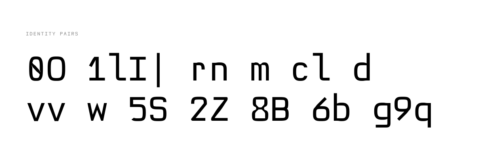
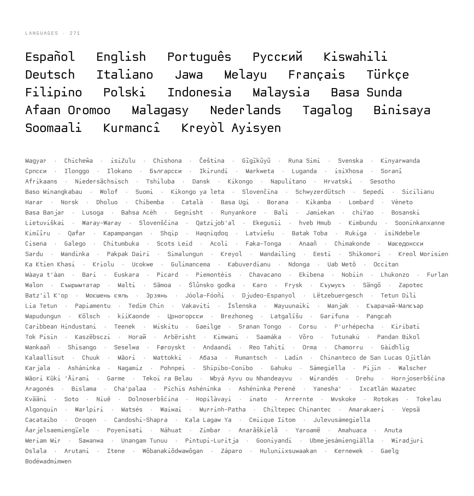
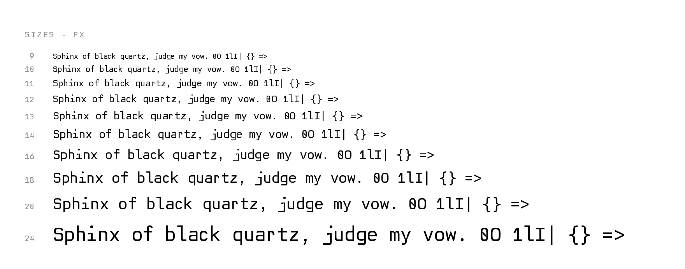

<p align="center">
  
</p>

<h1 align="center">Kubet Mono</h1>

<p align="center">A monospace drawn entirely by code.<br>
879 characters · 271 languages · box drawing, braille, Powerline</p>

<p align="center">
  <a href="https://github.com/kubet/kubet-mono/releases/latest">Download</a> ·
  <a href="https://dropthetable.com/kubet-mono">Specimen</a> ·
  <a href="LICENSE.md">License</a>
</p>

## Install

```sh
# macOS
curl -L -o ~/Library/Fonts/KubetMono-Regular.ttf \
  https://github.com/kubet/kubet-mono/releases/latest/download/KubetMono-Regular.ttf

# Linux
curl -L --create-dirs -o ~/.local/share/fonts/KubetMono-Regular.ttf \
  https://github.com/kubet/kubet-mono/releases/latest/download/KubetMono-Regular.ttf && fc-cache -f
```

Windows: download the TTF, right-click, Install.

```jsonc
// VS Code
"editor.fontFamily": "Kubet Mono"
```

```ini
# Ghostty
font-family = Kubet Mono
font-feature = ss01   # zero with a vertical bar
font-feature = ss02   # l with slabs on both sides
```

<picture>
  <source media="(prefers-color-scheme: dark)" srcset="docs/plates/pairs-dark.svg">
  
</picture>

<picture>
  <source media="(prefers-color-scheme: dark)" srcset="docs/plates/languages-dark.svg">
  
</picture>

<picture>
  <source media="(prefers-color-scheme: dark)" srcset="docs/plates/water-dark.png">
  
</picture>

## Measured

Average rank over ten legibility measures against 16 monospaces, FreeType at 9–16 px. Lower is better.

| Font | Rank |
| --- | ---: |
| **Kubet Mono** | **4.1** |
| JetBrains Mono | 6.6 |
| Cascadia Code | 6.8 |
| Go Mono | 7.4 |
| DejaVu Sans Mono | 7.8 |
| Hack | 8.0 |
| Fira Code | 8.2 |

<details>
<summary>Datasheet</summary>

| | |
| --- | --- |
| Version | 0.002 · 2026-10-28 |
| Advance | 600 of 1000 units, fixed |
| Cap height · x-height | 700 · 524 |
| Line height | 1.332 em |
| Features | `ss01` vertical-bar zero, `ss02` slab l, `locl` Serbian and Macedonian forms |
| Coverage | Latin-1, Latin Extended-A, Cyrillic U+0400–045F, box drawing, block elements, braille, Powerline |
| Languages | 271 by [hyperglot](https://github.com/rosettatype/hyperglot) (base characters) |

| File | SHA-256 |
| --- | --- |
| `fonts/ttf/KubetMono-Regular.ttf` | `d6376576da5f130670757ac345eda2b7a46121614e21636e6b3703c22f3c4ce7` |
| `fonts/otf/KubetMono-Regular.otf` | `34caf0bdafd3ec3babc2e70cc42f5990979d3729d221e7995840098fda461349` |
| `fonts/web/KubetMono-Regular.woff2` | `c031b6ccb0a5215a770e947d6c66bf106849182c5a491c53088a972ad098a7d9` |

</details>

## License

[Kubet Mono License 1.2](LICENSE.md)

- Free on your own devices, for any purpose.
- Shipping it in anything (web font, app, package, theme, mirror) needs written approval first. It is free: mail the project to vukasin@dropthetable.com.
- No selling, no training outline models on it. Derivatives are renamed.

© 2026 Vukašin Kubet · [drop.table](https://dropthetable.com)
