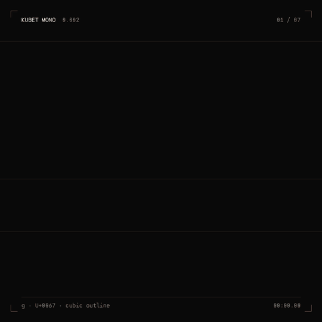

<p align="center">
  
</p>

<h1 align="center">Kubet Mono</h1>

<p align="center"><b>A monospace drawn entirely by code.</b><br>
An autonomous AI loop wrote the engine, drew every glyph and measured it against 16 monospaces for six days.<br>
879 glyphs · Latin and Cyrillic · box drawing, braille, Powerline · free on your own machine.</p>

<p align="center">
  <a href="https://github.com/kubet/kubet-mono/releases/latest">Download</a> ·
  <a href="https://dropthetable.com/kubet-mono">Specimen and type tester</a> ·
  <a href="LICENSE.md">License</a>
</p>

<picture>
  <source media="(prefers-color-scheme: dark)" srcset="docs/plates/code-dark.png">
  
</picture>

## Install

Download the [latest release](https://github.com/kubet/kubet-mono/releases/latest) or take the files from `fonts/`.

```sh
# macOS
curl -LO https://github.com/kubet/kubet-mono/releases/latest/download/KubetMono-Regular.ttf
mv KubetMono-Regular.ttf ~/Library/Fonts/

# Linux
mkdir -p ~/.local/share/fonts
curl -L -o ~/.local/share/fonts/KubetMono-Regular.ttf \
  https://github.com/kubet/kubet-mono/releases/latest/download/KubetMono-Regular.ttf
fc-cache -f
```

Windows: download the TTF, right-click, Install.

```jsonc
// VS Code
"editor.fontFamily": "Kubet Mono",
"editor.fontLigatures": false
```

```ini
# Ghostty
font-family = Kubet Mono
font-feature = ss01   # zero with a vertical bar instead of the diagonal
font-feature = ss02   # l with slabs on both sides
```

```css
@font-face {
  font-family: "Kubet Mono";
  src: url("KubetMono-Regular.woff2") format("woff2");
  font-weight: 400;
  font-display: swap;
}
```

<picture>
  <source media="(prefers-color-scheme: dark)" srcset="docs/plates/term-dark.png">
  
</picture>

<picture>
  <source media="(prefers-color-scheme: dark)" srcset="docs/plates/pairs-dark.png">
  
</picture>

## Measured, not claimed

Every build is scored against 16 monospaces on ten legibility measures, rendered with FreeType at the sizes code is read at (9–16 px, with and without hinting). Lower average rank is better.

| Font | Average rank |
| --- | ---: |
| **Kubet Mono** | **4.1** |
| JetBrains Mono | 6.6 |
| Cascadia Code | 6.8 |
| Go Mono | 7.4 |
| DejaVu Sans Mono | 7.8 |
| Hack | 8.0 |
| Fira Code | 8.2 |

Kubet is first on mean look-alike margin, edge sharpness and 1× edge sharpness, and second on the worst look-alike pair. It still trails on gray evenness (#6), texture (#7) and characters per line (#11). This is Kubet's own benchmark, not a reading study.

<picture>
  <source media="(prefers-color-scheme: dark)" srcset="docs/plates/water-dark.png">
  
</picture>

## Datasheet

| | |
| --- | --- |
| Family · style | Kubet Mono · Regular (400), upright |
| Version | 0.002 · 2026-10-28 |
| Units per em | 1000 |
| Advance width | 600, fixed; no kerning |
| Cap height · x-height | 700 · 524 |
| Ascender (l) · descender | 815 · −200 |
| Line height | 1.332 em (1093 / −239) |
| Stem | 92 units |
| Glyphs · codepoints | 927 · 879 |
| OpenType | `ccmp`, `locl` (Serbian, Macedonian), `ss01` vertical-bar zero, `ss02` slab l, `mark`, `mkmk` |
| Hinting | `prep` + `gasp`: grayscale antialiasing at every size |
| Embedding | `fsType` 0, installable |

### Coverage

| Block | Cells |
| --- | --- |
| Basic Latin | 95 / 95 |
| Latin-1 Supplement | 96 / 96 |
| Latin Extended-A | 128 / 128 |
| Latin Extended-B digraphs DŽ–nj | 9 / 9 |
| Cyrillic U+0400–045F | 96 / 96 |
| Combining marks | 13 |
| Arrows, math, bullet, ellipsis, check marks | 18 |
| Box Drawing | 128 / 128 |
| Block Elements | 32 / 32 |
| Braille Patterns | 256 / 256 |
| Powerline (private use) | 8 |

Languages: English and the Latin-1 and Extended-A languages (German, French, Spanish, Portuguese, Italian, Dutch, Polish, Czech, Slovak, Hungarian, Romanian, Turkish, Croatian, Slovene and more). Cyrillic: Serbian and Macedonian with their localized forms, Russian, Belarusian and Bulgarian. Ukrainian except Ґ ґ.

### Files

| File | Size | SHA-256 |
| --- | --- | --- |
| `fonts/ttf/KubetMono-Regular.ttf` | 139,120 B | `d6376576da5f130670757ac345eda2b7a46121614e21636e6b3703c22f3c4ce7` |
| `fonts/otf/KubetMono-Regular.otf` | 86,748 B | `34caf0bdafd3ec3babc2e70cc42f5990979d3729d221e7995840098fda461349` |
| `fonts/web/KubetMono-Regular.woff2` | 31,612 B | `c031b6ccb0a5215a770e947d6c66bf106849182c5a491c53088a972ad098a7d9` |

## Design notes

- **Fixed cells.** Every spacing glyph has one advance; marks have zero. No kerning or contextual alternates rescue a bad default. The grid is the contract.
- **Round but serious.** Gently squared superelliptic rounds, flat precise terminals, nothing bubbly. The capital O and lowercase o are the master rounds; every curve derives from them.
- **Letter fit.** The gap between two `n` is about 0.70 of the counter width, inside the 0.65–0.80 band that compact monospaces share, so text is dense without crowding.
- **Identity by shape, not width.** The zero is a narrower oval with a diagonal marker (a vertical bar via `ss01`), the lowercase l hooks, the capital I has slabs, the one has a flag and a foot.
- **Settled by measurement.** When a form is a judgment call, the engine measures what the genre does and takes its median. That is how `ø` got its 56° slash and `æ` its two balanced counters.
- **Original construction.** Only Kubet's programs and parameters produce ink. Other monospaces were measured as peers, never traced.

## License

[Kubet Mono License 1.2](LICENSE.md).

- **Use:** free on your own devices, any purpose, personal or paid.
- **Shipping it** (web font, app, OS, package, theme, mirror): written approval first, free, the anti-slop clause. Mail the project to vukasin@dropthetable.com.
- **One source:** the files are distributed from this repository only.
- No selling. Derivatives renamed. No training outline models on it. No warranty.

Kubet Mono © 2026 Vukašin Kubet · [drop.table](https://dropthetable.com)
